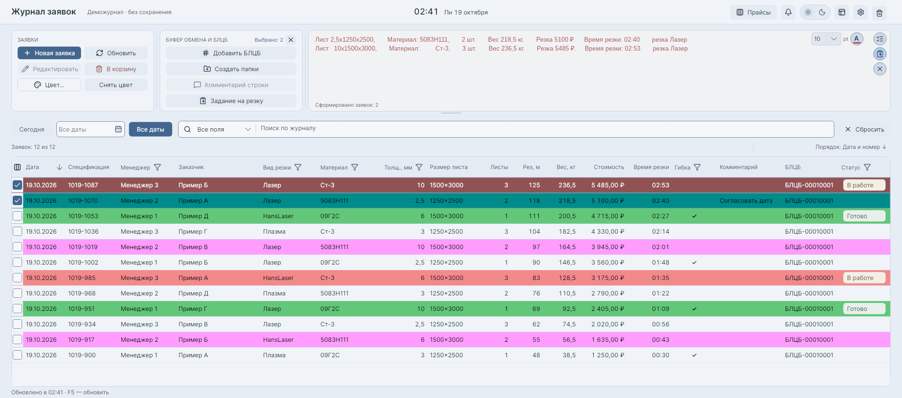
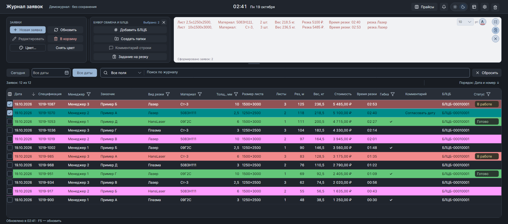
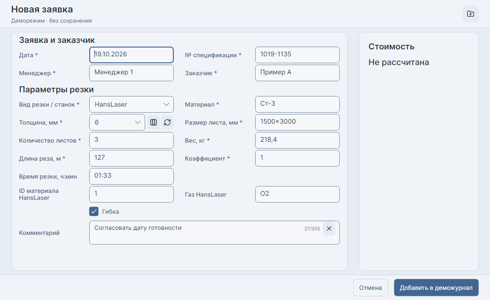

# Journal

Журнал заявок на лазерную, плазменную и гидроабразивную резку на **C# / .NET 10 / Avalonia**. Развивает [прежнюю WinForms-программу](https://github.com/DenisPapushaJava/Jornal), сохраняя работу с `OrderDB.mdb` и существующими спецификациями.

**[Скачать приложение](https://github.com/DenisPapushaJava/journal-v2.0/releases)** · [Документация](docs/development.md)

Сейчас приложение выпускается в **alpha**: основные рабочие сценарии реализованы, проверка в повседневной работе продолжается.

## Возможности

- Создание и редактирование заявок; одиночный и пакетный импорт HTML БЛОК/Wintech и PDF HansLaser / ГАР AWJC.
- Расчёт стоимости, редактирование прайсов, добавление станков и толщин, экспорт цен в Excel.
- Поиск по журналу, фильтры, цвета строк, БЛЦБ, время резки, гибка и комментарии.
- Подготовка текста для письма и задания на резку, создание папок, локальная корзина с восстановлением.
- Светлая и тёмная темы, настройка панелей и таблицы, обновления через колокольчик.

## Интерфейс

Журнал в светлой теме. Все данные на снимках вымышленные.



<details>
<summary>Тёмная тема и форма новой заявки</summary>





</details>

## Установка

**Windows 10/11 x64:** скачайте `OfflineSetup.exe` со [страницы выпусков](https://github.com/DenisPapushaJava/journal-v2.0/releases). Установщик включает необходимые среды .NET и модуль работы с MDB. Путь к базе указывается в **Настройки → База данных**.

**Linux:** разработка и запуск из исходников поддерживаются; новые готовые пакеты пока выпускаются только для Windows. Настоящая MDB доступна для чтения, для разработки предусмотрена [отдельная редактируемая копия](docs/linux-local-copy.md).

Собственные исполняемые файлы пока не подписаны: Windows Smart App Control или корпоративная политика могут блокировать запуск. [Установка и диагностика](docs/windows-installer.md) · [Статус подписи](docs/code-signing-policy.md).

## Разработка

Новое решение — `Jornal.Modern.slnx`; исходники приложения — в `src/`, тесты — в `tests/`. Старый WinForms-проект сохранён отдельно в этом репозитории.

На Linux:

```bash
./scripts/setup.sh   # установить закреплённый SDK и восстановить зависимости
./scripts/dev.sh     # запустить приложение
./scripts/check.sh   # Release-сборка и тесты
```

Для первого запуска нужен интернет; для интерфейса — графическая сессия. В VS Code откройте папку проекта, установите рекомендованные расширения и выберите **F5 → Jornal Desktop**. Перед запуском собираются текущие изменения.

[Процесс разработки](docs/development.md) · [CI](docs/ci.md) · [Версии и выпуски](docs/releases.md) · [Совместимость MDB](docs/order-maintenance.md) · [Импорт спецификаций](docs/specification-import.md)

## Лицензия

[MIT](LICENSE). Лицензии сторонних компонентов — в [docs/licenses](docs/licenses).
